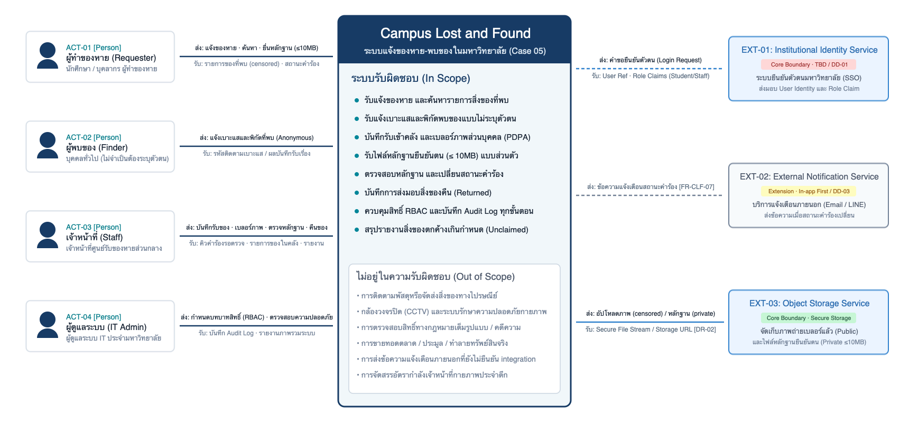
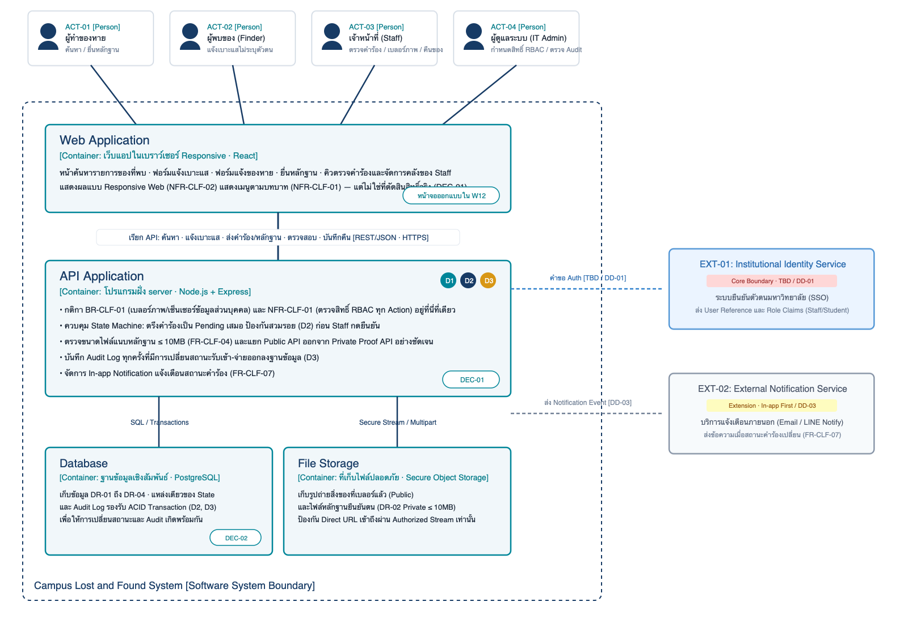

# Conceptual Architecture — Campus Lost and Found (ไม่บังคับ)

> ไฟล์นี้เป็นทางเลือก ใช้สรุปสั้นให้อ่านบน GitHub ได้ · เอกสารหลักคือ `design/11-conceptual-architecture-v0.1.docx`  
> ถ้าข้อความในไฟล์นี้ไม่ตรงกับไฟล์ Word ให้ถือไฟล์ Word เป็นหลัก

| รายการ | ค่า |
|---|---|
| **ระบบ** | Campus Lost and Found (ระบบแจ้งของหาย-พบของในมหาวิทยาลัย) — Case 05 |
| **ทีม** | Group 05 · สมาชิก: ธนรัก ชุ่มสวัสดิ์ (Editor / Lead), นรบดี บุญเลิศ (Quality / Design) |
| **ฐาน SRS** | `docs/07-srs-v1.md` (`Case-05-SRS-W07-v1`) สถานะ Baseline Candidate — *not approved baseline*; OI-01 ถึง OI-08 ยังเปิด |
| **เอกสารหลัก** | [`11-conceptual-architecture-v0.1.docx`](11-conceptual-architecture-v0.1.docx) — Design Draft · 11 หัวข้อ · ภาพที่ 1–5 |
| **ข้อมูลเข้า** | [`design/10-design-strategy.md`](10-design-strategy.md) + [`design/00-design-spine.md`](00-design-spine.md) (W10) |
| **Stack อ้างอิง** | React · Node.js + Express · PostgreSQL — Proposed (ให้ Dev ยืนยัน: DD-06) |
| **Change request ที่รู้** | `CR-01-SIM` (AI Auto-matching) — Pending (ไม่นำมาใช้ในรุ่นแรกนี้) |

---

## ภาพสถาปัตยกรรม

### ภาพที่ 2 — C4 ระดับ 1: System Context Diagram

*Campus Lost and Found 1 กล่องส่วนกลาง · ผู้ใช้ 4 บทบาท (ACT-01 Requester, ACT-02 Finder, ACT-03 Staff, ACT-04 IT Admin) · ระบบภายนอก (EXT-01 Identity [Core Boundary · TBD], EXT-02 Notification [Extension], EXT-03 Object Storage [Core Boundary]) · ต้นฉบับ [`11-context.drawio`](../diagrams/architecture/11-context.drawio)*

### ภาพที่ 3 — C4 ระดับ 2: Container Diagram

*C4 ระดับ 2: Web Application · API Application · Database · File Storage · ต้นฉบับ [`11-container.drawio`](../diagrams/architecture/11-container.drawio)*

> ภาพประกอบอื่นในเอกสาร Word (ดูต้นฉบับได้ที่ `diagrams/architecture/`):  
> - ภาพที่ 1 [`11-bridge-w10-to-w11.png`](../diagrams/architecture/11-bridge-w10-to-w11.png)  
> - ภาพที่ 4 [`11-where-containers-run.png`](../diagrams/architecture/11-where-containers-run.png)  
> - ภาพที่ 5 [`11-d2-where-the-rule-lives.png`](../diagrams/architecture/11-d2-where-the-rule-lives.png)

---

## Container (สรุปจากหัวข้อ 3–4)

| Container | [ชนิด · เทคโนโลยี] | หน้าที่ | รันที่ไหน / ใครควบคุม | ข้อมูลที่เก็บ | คุยกับ (ส่งอะไร) |
|---|---|---|---|---|---|
| **Web Application** | เว็บแอปในเบราว์เซอร์ Responsive · React | หน้าจอสำหรับผู้ใช้ทุกบทบาท: ค้นหารายการของที่พบ · ฟอร์มแจ้งเบาะแสไม่ระบุตัวตน · ฟอร์มแจ้งของหาย · ฟอร์มยื่นหลักฐาน · คิวตรวจคำร้องและจัดการคลังของเจ้าหน้าที่ · แสดงเมนูตาม role | เบราว์เซอร์บนเครื่องหรือสมาร์ตโฟนของผู้ใช้ — ผู้ใช้ควบคุม | ไม่เก็บข้อมูลถาวร | API Application — เรียก REST API ผ่าน HTTPS [REST/JSON] |
| **API Application** | โปรแกรมฝั่ง server · Node.js + Express | ศูนย์กลางบังคับกติกา BR-CLF-01 (เบลอร์ภาพ/เซ็นเซอร์ข้อมูลส่วนบุคคล) และ NFR-CLF-01 (ตรวจสิทธิ์ RBAC ทุก action) · ควบคุม State Guard ให้คำร้องตรึงที่ Pending เสมอ (D2) · ตรวจขนาดไฟล์แนบ ≤ 10MB (FR-CLF-04) · บันทึก Audit Log ทุก action (D3) · จัดการ In-app notification | server ของทีม — ทีมควบคุม | ไม่เก็บข้อมูลเอง — อ่าน/เขียนผ่าน Database และ File Storage | Database [SQL · transaction], File Storage [Secure Stream], EXT-01 [protocol = TBD / role fixture], EXT-02 [Extension] |
| **Database** | ฐานข้อมูลเชิงสัมพันธ์ · PostgreSQL | แหล่งความจริงเดียวของ State และ Audit Log · เก็บข้อมูลเชิงโครงสร้างทั้งหมด (DR-01 ข้อมูลของหาย, DR-02 Metadata หลักฐาน, DR-03 สถานะคำร้องและเหตุผล, DR-04 สิทธิ์ผู้ใช้, และตาราง AuditLog) | server ฐานข้อมูล — ทีมควบคุม · เข้าถึงผ่าน API เท่านั้น | ข้อมูลทั้งหมด (DR-01 ถึง DR-04, Audit Logs) | API Application เท่านั้น |
| **File Storage** | ที่เก็บไฟล์ปลอดภัย · Secure Object Storage | เก็บไฟล์รูปภาพสิ่งของที่ผ่านการเบลอร์แล้ว (Public Access ผ่าน API) และเก็บไฟล์หลักฐานยืนยันตน (DR-02 Private ≤ 10MB) ในพื้นที่เข้ารหัส ป้องกัน Direct URL | server จัดเก็บไฟล์ของทีม — ทีมควบคุม | Blurred item images, Encrypted private proof files | API Application เท่านั้น |

---

## NFR → Container (สรุปจากหัวข้อ 5)

| NFR | ต้องการอะไร (docs/07 หัวข้อ 4–5) | ผลต่อ container | สถานะ |
|---|---|---|---|
| **BR-CLF-01** | ปิดบังเลขบัตร ข้อมูลติดต่อ และภาพส่วนบุคคลก่อนเผยแพร่ | API Application มีโมดูล Redaction/Blurring Interceptor ก่อนส่งข้อมูลและภาพเข้า Storage/Database | DEC-01 |
| **NFR-CLF-01** | จำกัดสิทธิ์ตามบทบาท Public, Requester, Staff, Admin และซ่อนหลักฐานจากผู้ที่ไม่ใช่เจ้าหน้าที่ | API Application ตรวจสิทธิ์ทุก endpoint; File Storage แยก private proof bucket; Web Application แค่ซ่อนเมนู | DEC-01, DEC-02 |
| **FR-CLF-04 / CT-01** | ไฟล์แนบหลักฐานขนาดไม่เกิน 10MB ส่งแบบส่วนตัว | API Application ตรวจสอบ Content-Length และ Multipart stream ปฏิเสธไฟล์ที่เกิน 10MB ทันที | DEC-01 |
| **FR-CLF-05 / D2** | เปลี่ยนสถานะคำร้องเป็น pending, verified, rejected, returned พร้อมบันทึกเหตุผล | API Application คุม State Machine ห้ามข้ามขั้นตอน (Pending Gate) และบันทึกลง Database transaction เดียวกับ Audit Log | DEC-01, DEC-02 |
| **NFR-CLF-02** | แสดงผลแบบ Responsive Web บนอุปกรณ์มือถือ (โหลด ≤ 3s บน 4G) | Web Application ออกแบบเป็น Responsive UI รองรับหน้าจอคอมพิวเตอร์และมือถือ | ส่งต่อ W12 |

---

## Decision Cards (สถานะ Proposed)

| ID | ตัดสินใจ | เพราะ (NFR / driver) |
|---|---|---|
| **DEC-01** | กติกาความปลอดภัย การเซ็นเซอร์ข้อมูลส่วนบุคคล (BR-CLF-01) และการตรวจสิทธิ์ (NFR-CLF-01) อยู่ที่ API Application ไม่ใช่หน้าเว็บ | NFR-CLF-01 · BR-CLF-01 · D1 (Privacy Leak = พัง) · D2 (Pending Gate) · ผู้ใช้สามารถข้ามหน้าเว็บหรือยิง API ตรงได้ กติกาและความลับต้องอยู่ฝั่ง server |
| **DEC-02** | ฐานข้อมูลเดียวที่รองรับ transaction เป็นแหล่งความจริงของ State และ Audit Log (PostgreSQL) | D2 · D3 · FR-CLF-05 · NFR-CLF-01 · การเปลี่ยนสถานะคำร้องต้องผูกกับการบันทึก Audit Log ใน ACID transaction เดียวกันเสมอเพื่อป้องกันข้อมูลไม่สอดคล้อง |
| **DEC-03** | เว็บแอปเดียวแบบ Responsive Web Application รองรับทุก Actor ตามบทบาท (ไม่ต้องทำ Native Mobile App ในรุ่นแรก) | NFR-CLF-02 · UC-01 ถึง UC-06 · ทุก actor สามารถใช้งานผ่านหน้าจอเว็บเบราว์เซอร์ได้ทั้งบน PC และมือถือ ไม่มี requirement บังคับใช้ฮาร์ดแวร์เฉพาะของโทรศัพท์ |
| **DEC-04** | ใช้ stack อ้างอิงของรายวิชา: React · Node.js + Express · PostgreSQL (Proposed) | ตรงตามข้อกำหนดของ DEC-01–03 · PostgreSQL รองรับ ACID transactions · หน้าเว็บและ API ใช้ JavaScript/TypeScript ร่วมกัน · ทีมมีความคุ้นเคย |

---

## Open Decisions ที่เปิดอยู่ (สรุปจากหัวข้อ 8)

| ID | เรื่อง | กระทบ container | ระหว่างรอทำอย่างไร | เจ้าของคำตอบ |
|---|---|---|---|---|
| **DD-01** | Institutional Identity Service และ protocol/field ที่ส่งมา (OI-04) | API Application + EXT-01 | ใช้ role fixture / Mock JWT สำหรับทดสอบ 4 บทบาท · ไม่เก็บรหัสผ่าน | Security / IT Admin |
| **DD-02** | เทคนิคการเบลอร์และเซ็นเซอร์ภาพถ่าย (Manual vs Automatic) (OI-06) | API Application + File Storage | รุ่นแรกรองรับ Manual Blurring โดยเจ้าหน้าที่ตรวจสอบและเซ็นเซอร์ก่อนกด Publish | ผู้ดูแลระบบ IT / ผู้บริหาร |
| **DD-03** | ช่องทางการแจ้งเตือนอัตโนมัติภายนอก (Email vs LINE Notify) (OI-08) | API Application + EXT-02 | รุ่นแรกใช้วิธีแสดงผล In-app Notification บนหน้าเว็บของผู้ใช้ | ผู้ดูแลระบบ IT |
| **DD-04** | นโยบายระยะเวลาจัดเก็บสิ่งของตกค้าง (OI-07) | API Application + Database | รุ่นแรกใช้ตัวกรอง 30 วันในรายงานของตกค้าง (Overview) โดยยังไม่ทำการตัดโอนหรือทำลายของจริง | ผู้บริหารมหาวิทยาลัย |
| **DD-05** | นโยบายการสำรองข้อมูลและระยะเวลาจัดเก็บหลักฐานส่วนบุคคล (Data Retention) | Database + File Storage | ไม่ลบไฟล์หลักฐานและ audit log ในรุ่นแรกระหว่างรอนโยบาย PDPA มหาวิทยาลัย | Data / Compliance Reviewer |
| **DD-06 (ใหม่)** | ยืนยัน version ของ Stack และเครื่องมือทดสอบ | ทุก container | ใช้ stack อ้างอิงตาม DEC-04 ระหว่างรอ Dev ยืนยัน | ทีมพัฒนาระบบ (Dev) |
